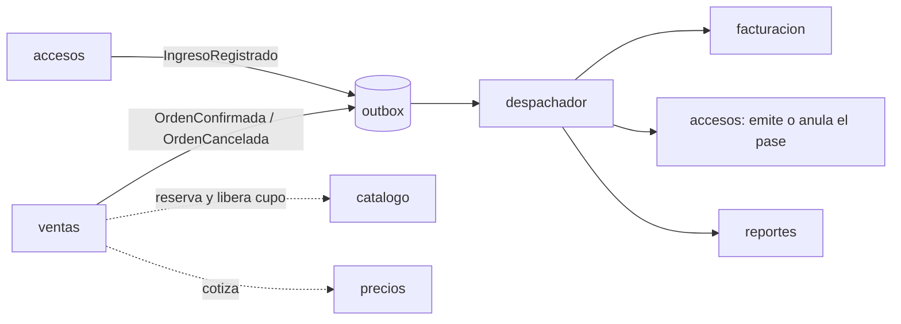
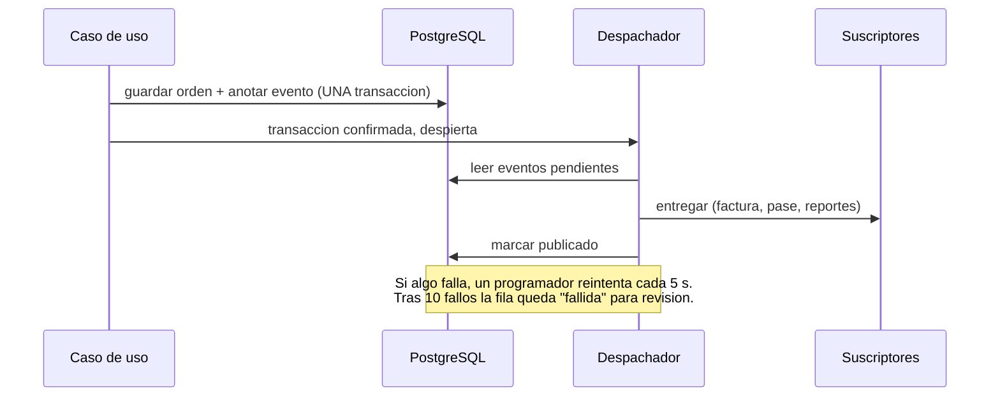

# ticketing-parques

[](https://github.com/Orlando-Diaz/ticketing-parques/actions/workflows/ci.yml)

Venta de entradas y control de acceso para parques y eventos. Es un **monolito modular con arquitectura hexagonal**
(Java 21, Spring Boot 4, PostgreSQL) hecho para practicar SOLID y para resolver, con pruebas, los problemas que
aparecen cuando un sistema de tickets se usa de verdad: mucha gente comprando a la vez, eventos que no pueden
perderse y una puerta que no debe dejar entrar a nadie de mas.

## Que demuestra este proyecto
- **Nunca se vende mas que el cupo**, aunque compren cientos a la vez (bloqueo optimista + reintentos + restriccion en la base). [Ver como](#como-evite-la-sobreventa)
- **Los eventos no se pierden** si el servidor se cae: patron *outbox* con entrega al menos una vez y consumidores idempotentes. [ADR 0007](docs/adr/0007-outbox-eventos-atomicos-con-el-cambio.md)
- **Modulos independientes**: ventas no sabe que existen facturacion, accesos ni reportes; una prueba de arquitectura (ArchUnit) falla el build si alguien lo rompe.
- **Seguridad por roles** con JWT: el visitante compra sin cuenta; la puerta y la administracion tienen su propio acceso. [ADR 0008](docs/adr/0008-seguridad-jwt-y-roles.md)
- **Probado donde importa**: unas 200 pruebas, y las de base de datos tambien corren contra un PostgreSQL real en Docker. [ADR 0009](docs/adr/0009-tests-contra-postgresql-real-con-testcontainers.md)
- **Cada decision esta explicada** en un [ADR](docs/adr) (que se eligio, por que y que se sacrifico).

## Arquitectura
Cada modulo es dueno de su dominio y de sus tablas. Se comunican por **eventos**, nunca llamandose entre si ni leyendose las tablas.



Dentro de cada modulo, las dependencias apuntan hacia el dominio:

```
infrastructure (web, JPA/JDBC, listeners)  -->  application (casos de uso, puertos)  -->  domain (reglas)
```
`domain` y `application` no usan Spring (lo verifica ArchUnit); la conexion entre las piezas ocurre en un solo lugar, las clases `*Config`.

| Modulo | Responsabilidad |
|---|---|
| catalogo | Parques, aforo y cupo por dia |
| precios | Motor de tarifas (unica o por categoria) con reglas de descuento y recargo |
| ventas | Ordenes: compra, cancelacion |
| facturacion | Facturas a partir de las ventas (por eventos) |
| accesos | Un pase (QR) por compra y validacion en la puerta, con ingresos parciales |
| reportes | Modelo de lectura: ventas, cancelaciones e ingresos por dia |
| seguridad | Usuarios, login y roles |

## Como evite la sobreventa
**El problema.** Dos compradores leen "quedan 5", cada uno reserva 5 y ambos guardan: se vendieron 10. Pasa con cualquier "leer, modificar, guardar".

**La solucion, en tres capas:**
1. **Bloqueo optimista.** El cupo del dia tiene una columna `version`. Al guardar, la base solo acepta el cambio si la version sigue siendo la que se leyo; si otro se adelanto, el guardado falla con un conflicto.
2. **Reintento.** El caso de uso, ante un conflicto, vuelve a leer el cupo (ya con la venta del otro) y vuelve a intentar. Si ya no queda cupo, el comprador recibe "cupo agotado"; si hay, compra. Cada conflicto lo provoca la venta *exitosa* de otro, asi que el sistema siempre avanza.
3. **Ultima defensa en la base.** Una restriccion `CHECK (vendidas <= cupo_maximo)`: aunque un error de programacion se saltara todo lo anterior, PostgreSQL rechaza la venta de mas.

**La prueba** ([`ConcurrenciaCupoJpaTest`](src/test/java/com/orlandodiaz/ticketing/persistencia/ConcurrenciaCupoJpaTest.java)): 20 compradores arrancan al mismo tiempo sobre un parque con 5 entradas. El resultado debe ser siempre 5 compras exitosas, 15 rechazadas por cupo agotado y 5 vendidas guardadas. Corre contra H2 y contra PostgreSQL real.

**El mismo patron protege otros dos puntos:**
- *Cancelaciones simultaneas*: sin proteccion, dos cancelaciones de la misma orden devolverian el cupo dos veces. La orden tambien lleva `version`; solo gana una cancelacion y solo ella devuelve el cupo.
- *Puertas simultaneas*: dos puertas escanean el mismo QR a la vez; el pase lleva `version` y una restriccion `entradas_usadas <= entradas_totales`, asi nunca entran mas personas que las compradas.

Detalle y alternativas descartadas (bloqueo pesimista, cola): [ADR 0004](docs/adr/0004-concurrencia-del-cupo-bloqueo-optimista.md).

## Como se comunican los modulos sin perder eventos
Guardar la venta y avisar a los demas son dos escrituras distintas; si el servidor muere entre las dos, la venta existe pero no hay factura, pase ni reporte. La solucion es el **outbox**:



La entrega es *al menos una vez*, asi que todos los suscriptores son **idempotentes** (reportes guarda hechos, no contadores; un evento repetido choca con una llave primaria y se ignora). [ADR 0007](docs/adr/0007-outbox-eventos-atomicos-con-el-cambio.md)

## Seguridad
| Quien | Puede |
|---|---|
| Visitante (sin cuenta) | Consultar disponibilidad y precios, comprar, y ver o cancelar su orden, factura y pase |
| `PUERTA` | Validar QR y consultar pases |
| `ADMIN` | Todo lo anterior, mas parques, precios, reportes y usuarios |

Login con `POST /api/auth/login` (JWT de 60 minutos). Las claves se guardan con BCrypt y los secretos llegan solo por variables de entorno. Una ruta nueva que no se liste exige estar autenticado: nada queda abierto por olvido.

## Pruebas
- **Dominio y casos de uso** con repositorios en memoria: rapidas, sin Spring.
- **Concurrencia**: barreras de hilos para forzar la carrera (compras, cancelaciones, ingresos) y pruebas con muchos hilos a la vez.
- **Persistencia y API** contra H2 y, con Docker, contra **PostgreSQL real** (Testcontainers): las mismas pruebas, dos motores.
- **Arquitectura** con ArchUnit: ventas no conoce a facturacion, accesos ni reportes; el dominio no usa frameworks; seguridad no conoce el negocio.
- **CI** en GitHub Actions: cada push compila y corre todo.

## Ejecutar
Necesita Java 21, Maven y PostgreSQL con una base vacia llamada `ticketing_parques` (Flyway crea las tablas al arrancar).

```powershell
# Las credenciales van en variables de entorno, nunca en el codigo
$env:DB_PASSWORD = "tu_contrasena"
$env:JWT_SECRET = "una-cadena-aleatoria-de-al-menos-32-caracteres"   # firma los tokens (obligatoria)
$env:ADMIN_PASSWORD = "clave-de-admin-de-10+-caracteres"             # crea al usuario "admin" la primera vez
# opcionales: DB_USER=postgres, DB_URL=jdbc:postgresql://localhost:5432/ticketing_parques

mvn test                 # H2 en memoria; con Docker en marcha tambien contra PostgreSQL real
mvn spring-boot:run      # API en http://localhost:8080
```

### Con Docker (un solo comando)
No necesitas instalar Java ni PostgreSQL, solo Docker.

```powershell
copy .env.example .env      # y edita .env con tus valores (el archivo .env nunca se sube a Git)
docker compose up --build   # compila, levanta PostgreSQL y la API en http://localhost:8080
```
La base de datos queda dentro de la red de Docker (no se expone en tu maquina) y sus datos se conservan en un volumen. Para apagar todo: `docker compose down` (con `-v` tambien borra los datos).

### Desplegar en Render
El archivo [render.yaml](render.yaml) describe todo (la API con el Dockerfile y una base PostgreSQL):
1. Sube el repo a GitHub y en Render elige **New > Blueprint**, apuntando al repo.
2. Render te pide `ADMIN_PASSWORD` (la clave del usuario `admin`); `JWT_SECRET` lo genera solo y la conexion a la base se configura sola.
3. Al terminar, la API queda en `https://<tu-servicio>.onrender.com`. Usa esa URL en lugar de `localhost:8080` en `docs/api.http`.

Con los planes gratuitos, la API se duerme tras un rato sin trafico (la primera peticion tarda en despertarla) y la base gratuita caduca a los 30 dias. Sirve para mostrar el proyecto, no para uso real.

Ejemplos de peticiones (con login incluido) en [docs/api.http](docs/api.http).

## API
| Metodo | Ruta | Acceso | Que hace |
|---|---|---|---|
| POST | /api/auth/login | publico | Cambia usuario y clave por un token |
| POST | /api/usuarios | ADMIN | Crea un usuario (ADMIN o PUERTA) |
| POST | /api/parques | ADMIN | Registra un parque |
| PUT | /api/parques/{id}/precios | ADMIN | Configura tarifas y reglas del parque |
| GET | /api/parques/{id}/precios/cotizacion | publico | Cotiza una entrada |
| GET | /api/parques/{id}/disponibilidad?fecha= | publico | Cupo disponible |
| POST | /api/ordenes | publico | Compra entradas |
| GET | /api/ordenes/{id} | publico | Consulta una orden |
| POST | /api/ordenes/{id}/cancelacion | publico | Cancela una orden |
| GET | /api/ordenes/{id}/factura | publico | Factura de la orden |
| GET | /api/ordenes/{id}/pase | publico | Pase de la orden (el codigo es el QR) |
| POST | /api/accesos/ingresos | PUERTA, ADMIN | Escanea el QR y deja entrar a N personas |
| GET | /api/accesos/pases/{codigo} | PUERTA, ADMIN | Estado de un pase y su historial |
| GET | /api/reportes/parques/{id}/dia?fecha= | ADMIN | Resumen de un dia: ventas, cancelaciones, ingresos |
| GET | /api/reportes/parques/{id}/rango?desde=&hasta= | ADMIN | Un resumen por dia con actividad (maximo 366 dias) |

## Decisiones de arquitectura
| ADR | Tema |
|---|---|
| [0001](docs/adr/0001-hexagonal-monolito-modular.md) | Hexagonal y monolito modular |
| [0002](docs/adr/0002-tarifas-configurables-por-parque.md) | Tarifas configurables por parque |
| [0003](docs/adr/0003-persistencia-flyway-jpa-separado-del-dominio.md) | Persistencia: Flyway y JPA separado del dominio |
| [0004](docs/adr/0004-concurrencia-del-cupo-bloqueo-optimista.md) | Concurrencia del cupo: bloqueo optimista |
| [0005](docs/adr/0005-modulo-accesos-un-pase-por-compra.md) | Accesos: un pase por compra |
| [0006](docs/adr/0006-reportes-modelo-de-lectura-por-eventos.md) | Reportes como modelo de lectura |
| [0007](docs/adr/0007-outbox-eventos-atomicos-con-el-cambio.md) | Outbox |
| [0008](docs/adr/0008-seguridad-jwt-y-roles.md) | Seguridad: JWT y roles |
| [0009](docs/adr/0009-tests-contra-postgresql-real-con-testcontainers.md) | Pruebas contra PostgreSQL real |

## Limites conocidos
Dicho con honestidad, lo que este proyecto todavia no resuelve (cada punto esta detallado en su ADR):
- No hay pasarela de pago: la orden se confirma al comprar.
- El token JWT no se puede revocar antes de vencer y el login no limita intentos.
- Si falla la devolucion del cupo despues de cancelar, el cupo queda ocupado (el lado seguro); cerrarlo del todo seria llevar tambien esa devolucion al outbox.
- El outbox no limpia filas antiguas y, con varias instancias, dos despachadores podrian entregar el mismo evento (es seguro por la idempotencia, pero repite trabajo).
- No hay interfaz grafica: solo la API REST.
